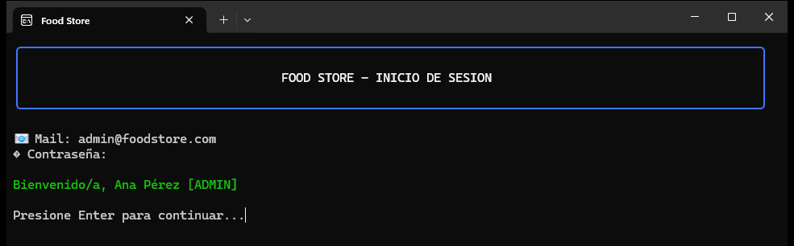
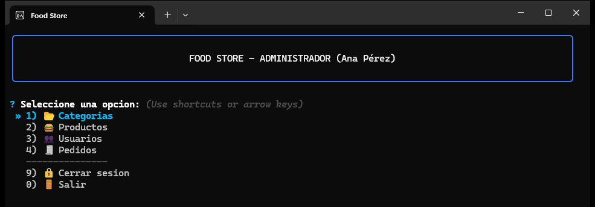
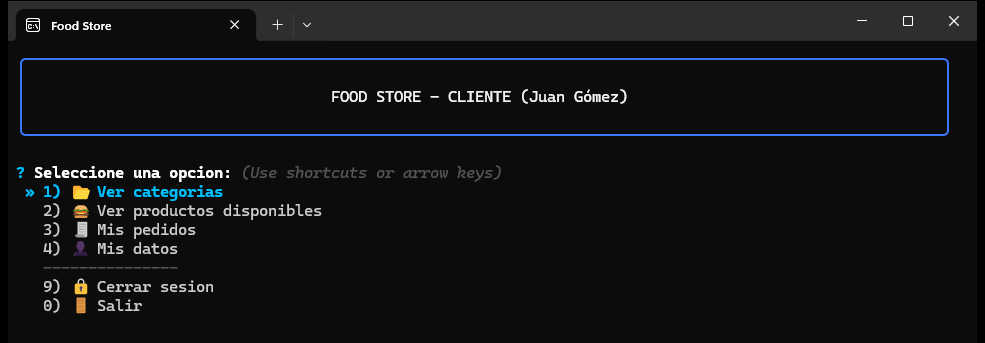
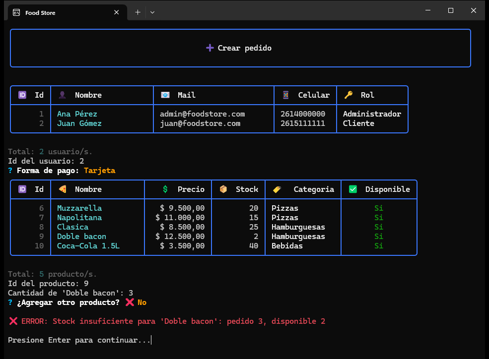
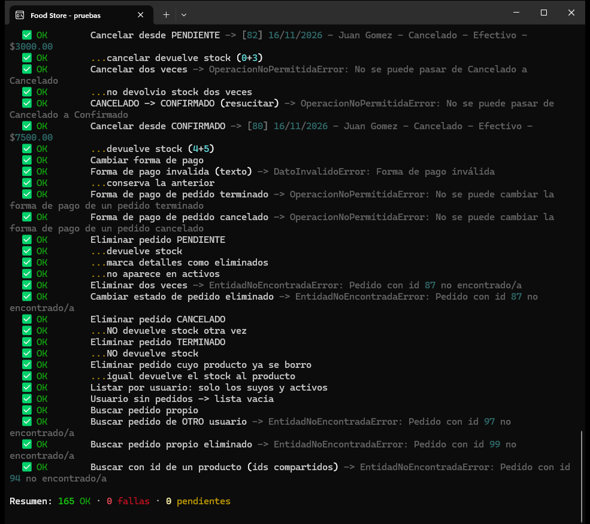

<div align="center">

**Universidad Tecnológica Nacional – Facultad Regional Mendoza**

**Tecnicatura Universitaria En Programación**

**Programación II**

# Trabajo Práctico Integrador
## Food Store – Sistema de gestión de pedidos de comida

| Integrante | Legajo |
|---|---|
| Luciano Pizarro | 54249 |
| Lautaro Martínez | 54277 |

Fecha de entrega: 18/11/2026

</div>

---

## Índice

1. [Introducción](#1-introducción)
2. [Marco teórico](#2-marco-teórico)
3. [Decisiones técnicas y arquitectura](#3-decisiones-técnicas-y-arquitectura)
4. [Capturas del sistema](#4-capturas-del-sistema)
5. [Dificultades y soluciones](#5-dificultades-y-soluciones)
6. [Bibliografía y webgrafía](#6-bibliografía-y-webgrafía)
7. [Enlaces](#7-enlaces)

> Los números de página se agregan al exportar a PDF.

---

## 1. Introducción

Food Store es un programa de consola para administrar un negocio de comidas. Permite cargar categorías, productos, usuarios y pedidos, y controla el stock a medida que los pedidos se crean, se cancelan o se eliminan.

Al iniciar se pide mail y contraseña. Un administrador puede dar de alta, modificar, dar de baja y consultar todo. Un cliente solo consulta: ve las categorías, los productos que hay para pedir, sus propios pedidos y sus datos. Los datos viven en memoria y se pierden al cerrar el programa, como pide la consigna.

El trabajo se dividió en dos partes. La parte A (Lautaro) se ocupó del acceso, las categorías y los usuarios. La parte B (Luciano) se ocupó de los productos, los pedidos y el stock. Cada uno trabajó en su rama de Git y después las unimos en `main` con pull requests.

## 2. Marco teórico

### 2.1 Python y type hints

Python es un lenguaje interpretado y de tipado dinámico: una variable no tiene un tipo fijo y los errores de tipo aparecen recién al ejecutar. Los *type hints* (PEP 484) permiten anotar qué tipo se espera en cada atributo, parámetro y retorno. El intérprete no los hace cumplir, pero documentan el contrato de cada función y los editores los usan para avisar errores antes de correr el programa.

En el proyecto todas las funciones y métodos tienen sus anotaciones. Algunos ejemplos son `def buscar_por_id(self, id_buscado: int) -> T`, `tuple[DetallePedido, ...]` para una tupla de largo variable y `DetallePedido | None` para "un detalle o nada".

### 2.2 Clase abstracta

Una clase abstracta define lo que tienen en común varias clases, pero no se puede instanciar por sí sola. En Python se declara heredando de `ABC`, del módulo `abc`.

`Base` es la superclase de todas las entidades. Da el `id`, la marca `eliminado` y la fecha `creado_en`, e implementa `eliminar()`, `__eq__` y `__hash__`. Si se intenta crear una `Base` directamente, el constructor lanza `TypeError`.

### 2.3 Interfaz

Python no tiene la palabra `interface`; se arma con una clase abstracta sin atributos y con métodos abstractos. `Calculable` define un único método, `calcular_total() -> None`. `Pedido` la implementa y la usa cada vez que se agrega o se quita un detalle. Cualquier clase que la implemente queda obligada a saber recalcular su propio total.

### 2.4 Herencia y sobrescritura

`Categoria`, `Producto`, `Usuario`, `Pedido` y `DetallePedido` heredan de `Base`, así que ninguna repite el manejo del id ni de la baja lógica. Cada una sobrescribe `__str__` con una línea útil para los listados. `Pedido` además sobrescribe `eliminar()`: llama al de `Base` con `super()` y después da de baja todos sus detalles.

### 2.5 Polimorfismo

El menú es el caso más claro. `Menu` es abstracta y tiene el método `mostrar()`. `MenuAdministrador` y `MenuCliente` lo implementan cada una a su manera. El rol se consulta una sola vez, en `crear_menu()`; a partir de ahí `main` llama a `menu.mostrar()` sin saber qué menú tiene. Para agregar un rol nuevo alcanza con una subclase más, sin tocar los menús existentes.

### 2.6 Encapsulamiento

Todos los atributos son privados (doble guion bajo, por ejemplo `self.__precio`) y se leen con `@property`. Solo tienen *setter* los que el sistema deja modificar, y el setter valida antes de guardar. Por ejemplo, un precio negativo, `NaN` o infinito lanza `PrecioInvalidoError`.

La contraseña es la excepción a propósito: tiene setter pero no tiene lectura. Para saber si es correcta se usa `verificar_contrasenia()`, así nunca sale del objeto.

### 2.7 Asociación, agregación y composición

- **Asociación (Usuario 1..N Pedido):** el usuario conoce sus pedidos y cada pedido sabe de quién es. Si se da de baja el usuario, sus pedidos siguen existiendo y se pueden consultar.
- **Agregación (Categoria 1..N Producto):** los productos existen por su cuenta. La relación se mantiene sincronizada en los dos sentidos: al cambiar la categoría de un producto, la vieja lo quita de su lista y la nueva lo agrega.
- **Composición (Pedido 1..N DetallePedido):** el detalle no tiene sentido fuera de su pedido. Solo `Pedido.agregar_detalle()` crea detalles, la lista se expone como tupla para que no se modifique desde afuera, y al eliminar el pedido se eliminan sus detalles.

### 2.8 Excepciones propias

Todas heredan de `FoodStoreError`, de modo que la consola puede capturar cualquier error de negocio con un solo `except`. Cada una describe un problema concreto:

| Excepción | Cuándo se lanza |
|---|---|
| `EntidadNoEncontradaError` | Id inexistente o dado de baja |
| `DatoInvalidoError` | Texto vacío, formato incorrecto, número fuera de rango |
| `PrecioInvalidoError` | Precio negativo o no numérico (hereda de `DatoInvalidoError`) |
| `StockInsuficienteError` | Se pide más cantidad de la que hay |
| `DuplicadoError` | Mail o nombre de categoría repetido |
| `OperacionNoPermitidaError` | Transición de estado inválida, categoría con productos activos, admin que se elimina a sí mismo |
| `CredencialesInvalidasError` | Mail o contraseña incorrectos, o usuario dado de baja |

### 2.9 Colecciones

Cada servicio guarda sus entidades en una lista. Las bajas son lógicas: el objeto queda en la lista con `eliminado = True` y los listados lo filtran. También usamos diccionarios (`TRANSICIONES_VALIDAS`, que asocia cada estado con los estados a los que puede pasar), conjuntos (los estados posibles desde uno dado) y tuplas (las copias de solo lectura de los detalles y de los productos de una categoría).

## 3. Decisiones técnicas y arquitectura

### 3.1 Capas y paquetes

```text
main.py                 Arranque: crea los servicios, carga los datos iniciales y alterna login ↔ menú
pruebas.py              Pruebas del modelo y los servicios, sin menú
datos_iniciales.py      Administrador inicial y datos de ejemplo
entidades/              Clases del UML (Base, Calculable, Categoria, Producto, Usuario, Pedido, DetallePedido)
enums/                  Rol, Estado, FormaPago
excepciones/            FoodStoreError y sus subclases
servicios/              Un servicio por entidad + ServicioBase
consola/                Login, menús, lectura validada, estilos y una pantalla por sección
```

Las dependencias van en un solo sentido: **consola → servicios → entidades**. Las entidades no usan `input()` ni `print()` y no conocen las colecciones. Los servicios no leen del teclado. La consola no tiene reglas de negocio: pide los datos, llama al servicio y muestra el resultado o el error.

### 3.2 Un servicio base genérico

Los cuatro servicios necesitan registrar, listar los activos y buscar por id. Para no repetir ese código hicimos `ServicioBase[T]`, una clase genérica con `TypeVar`. Cada servicio hereda de ella y solo agrega sus reglas. `buscar_por_id` lanza `EntidadNoEncontradaError` tanto si el id no existe como si está dado de baja, así que ninguna pantalla tiene que revisarlo por su cuenta.

Los servicios se agrupan en un `dataclass` llamado `Servicios`, que se crea en `main()` y se pasa a los menús. No hay variables globales, y la sesión también es una variable local de `main()`.

### 3.3 Ids compartidos

El id sale de un contador de clase en `Base` que comparten todas las entidades. Así no puede haber una categoría y un producto con el mismo id, y si alguien ingresa por error el id de un producto donde se esperaba un pedido, el sistema responde "no encontrado" en lugar de traer otra cosa.

### 3.4 Validaciones en dos niveles

La validación de cada dato está en el setter de la entidad, que es el único lugar donde no se puede saltear. Las reglas que involucran a varios objetos están en los servicios: el mail único, el nombre de categoría único sin distinguir mayúsculas, la categoría con productos activos, las transiciones de estado y el stock.

La consola agrega una capa más, pensada para el usuario. `pedir_entero`, `pedir_decimal` y `pedir_id` no devuelven nada hasta que el dato sea válido (por ejemplo, aceptan `1500,50` o `1500.50`). `pedir_validado` vuelve a preguntar el mail o el nombre de categoría apenas se detecta un duplicado, sin esperar al final del formulario.

### 3.5 Pedidos y stock

La creación de un pedido sigue un orden pensado para no dejar nada a medias:

1. Se busca el usuario y se crea el `Pedido` en estado PENDIENTE.
2. Cada producto se agrega con `agregar_detalle()`, que controla disponibilidad, cantidad y stock. Si el mismo producto aparece dos veces, se suma la cantidad en un solo detalle y el stock se controla sobre el total.
3. Se calcula el total con `calcular_total()`.
4. Recién si todo salió bien se descuenta el stock y se registra el pedido.

Si cualquier paso falla, la excepción sube antes del paso 4: el pedido no se guarda y el stock no cambia. Es lo que se ve en el video y en la captura del pedido rechazado por falta de stock.

El precio unitario del detalle se copia del producto en el momento de agregarlo. Si después se cambia el precio, los pedidos viejos conservan su total.

Al cancelar un pedido se devuelve el stock. Al eliminarlo se devuelve solo si no estaba TERMINADO ni CANCELADO; si estaba cancelado, el stock ya se había devuelto.

### 3.6 Ediciones "todo o nada"

Al editar un producto o un usuario se pueden cambiar varios campos a la vez. Si uno es inválido, se restauran los valores anteriores y el objeto queda como estaba. Sin esto, un nombre válido con un stock negativo dejaba el nombre cambiado y mostraba igual un error.

En el usuario hay un caso especial: la contraseña no tiene getter, así que no se puede guardar para restaurarla. Por eso es lo último que se asigna, cuando todo lo demás ya es válido.

### 3.7 Inicio de sesión y permisos

`autenticar()` lanza el mismo error en los tres casos (mail inexistente, usuario dado de baja o contraseña incorrecta), para no revelar qué dato falló. Hay tres intentos y la contraseña se escribe oculta con `getpass`.

Algunas reglas que agregamos para que los permisos no se puedan esquivar:

- Un administrador no puede eliminarse a sí mismo ni cambiar su propio rol.
- El mail de un usuario dado de baja queda reservado y no se puede reutilizar.
- Un cliente que pide ver el detalle de un pedido ajeno recibe "no encontrado", el mismo mensaje que si no existiera.

### 3.8 Un menú que no se cae

Cada pantalla se ejecuta dentro de `Menu._ejecutar()`, que captura `FoodStoreError`, `ValueError` y la cancelación del usuario, muestra el mensaje y vuelve al menú. Gracias a eso las pantallas no necesitan `try/except` propios y quedan cortas.

### 3.9 Bibliotecas de consola

La consigna pide usar solo la biblioteca estándar; consultamos con la cátedra y se aceptó usar dos bibliotecas externas en la capa de consola. Para la interfaz usamos `questionary` (menús que se recorren con flechas o con el número de la opción) y `rich` (títulos, colores y tablas). Están aisladas en el paquete `consola`: las entidades y los servicios usan solo la biblioteca estándar. Al iniciar, `verificar_dependencias()` comprueba que estén instaladas y, si faltan, indica el comando para instalarlas en lugar de cerrarse con un error.

### 3.10 Pruebas

`pruebas.py` ejecuta 170 casos sin pasar por el menú y muestra cada uno como OK o FALLA. Cubren casos válidos y de error: precios negativos, `NaN` o infinitos, stock insuficiente, pedidos que fallan a mitad de la carga, transiciones de estado inválidas, cancelaciones que devuelven el stock una sola vez, pedidos ajenos, mails duplicados y login con usuario dado de baja.

Para comprobar que las pruebas detectaban errores de verdad, introdujimos fallas a propósito en el código: quitamos la restauración al editar, descontamos el stock antes de validar y cancelamos sin devolver el stock. En todos los casos alguna prueba falló.

## 4. Capturas del sistema

**Inicio de sesión**



**Menú de administrador**



**Menú de cliente**



**Pedido rechazado por falta de stock** (Juan pide 3 "Doble bacon" y quedan 2: el pedido no se registra y el stock no cambia)



**Ejecución de pruebas.py**



## 5. Dificultades y soluciones

### Parte B – Luciano Pizarro

**Que un pedido fallido no dejara rastros.** La forma más directa de escribirlo es descontar el stock a medida que se agrega cada producto. Pero si el tercer producto no tiene stock, los dos primeros ya quedaron descontados y el pedido no existe. Por eso separamos las etapas: primero se arma y se valida el pedido completo, y solo al final se toca el stock y la colección. Hay una prueba que verifica justamente este caso.

**El mismo producto cargado dos veces.** Si se piden 3 y después 3 más de un producto que tiene 5, cada carga por separado pasa el control, pero juntas no. `agregar_detalle()` suma la cantidad que ya había en el pedido antes de compararla con el stock.

**Datos que parecen números pero no lo son.** `float("nan")` y `float("inf")` son floats válidos, y `nan < 0` da `False`, así que pasaban el control de "precio no negativo". Agregamos `math.isfinite()` en el setter. Algo parecido pasaba con `True`, que en Python es un `int`, así que los setters de stock y cantidad lo rechazan explícitamente.

**Ediciones a medias.** Al editar un producto con un dato válido y otro inválido, el primero quedaba guardado aunque se mostrara un error. Guardamos los valores anteriores y, si algo falla, se restauran.

### Parte A – Lautaro Martínez

**Un usuario dado de baja que bloqueaba a uno activo.** Al principio el mail único se controlaba solo contra los usuarios activos. Así se podía crear un usuario nuevo con el mail de uno eliminado. Pero `autenticar()` busca por mail y puede encontrar primero al eliminado, y entonces rechazaba al activo aunque la contraseña fuera correcta. Decidimos controlar el mail contra todos los usuarios, también los dados de baja, y por eso un mail eliminado queda reservado.

**Un administrador que se convertía en cliente.** Ya estaba bloqueado que un administrador se eliminara a sí mismo, pero podía editarse y cambiarse el rol a Cliente. Seguía con el menú de administrador abierto sin serlo. Aplicamos el mismo criterio que con la baja: `editar()` recibe el usuario de la sesión y lanza `OperacionNoPermitidaError` si intenta cambiar su propio rol. En la pantalla de edición, además, el rol directamente no se ofrece cuando uno se edita a sí mismo.

**Errores que aparecían al final del formulario.** En la primera versión, un mail repetido o con formato inválido recién se detectaba al guardar, después de completar todos los campos, y había que empezar de nuevo. Lo mismo pasaba con el nombre de una categoría repetida. Separamos esas validaciones en métodos públicos (`validar_mail_disponible`, `validar_nombre_unico`) y sumamos `pedir_validado()` en la consola, que vuelve a preguntar ese dato en el momento, con el mismo límite de tres intentos.

**Cambiar la contraseña sin obligar a escribirla.** Al editar un usuario, todos los campos se pueden dejar vacíos para conservarlos, pero la contraseña se pide oculta y no tenía esa opción. En lugar de cambiar la función de entrada, que usábamos los dos, antes de pedir la contraseña se pregunta "¿Cambiar la contraseña?".

**Ediciones de usuario a medias.** El mismo problema que en productos apareció al editar usuarios: con un mail válido y un apellido con números, el mail quedaba cambiado. Aplicamos la misma restauración, con un detalle propio: la contraseña no se puede leer, así que se asigna al final, cuando el resto de los datos ya pasó las validaciones (ver 3.6).

### Integración

Cada uno trabajó en su rama. Los archivos que tocamos los dos fueron `pruebas.py` y, en la consola, `main.py`, `entrada.py` y `dependencias.py`, donde la parte A agregó `pedir_validado()` y la limpieza de pantalla al iniciar. Antes de unir las ramas probamos el merge en una copia aparte y corrimos las pruebas con las dos partes juntas. Git combinó el archivo sin conflictos y todas las pruebas pasaron. Después unimos cada rama a `main` con su pull request.

## 6. Bibliografía y webgrafía

- Python Software Foundation. *Documentación de Python 3*. https://docs.python.org/es/3/
  - `abc` — Clases base abstractas. https://docs.python.org/es/3/library/abc.html
  - `enum` — Soporte para enumeraciones. https://docs.python.org/es/3/library/enum.html
  - `typing` — Soporte para type hints. https://docs.python.org/es/3/library/typing.html
  - `dataclasses`. https://docs.python.org/es/3/library/dataclasses.html
  - Funciones integradas: `property`. https://docs.python.org/es/3/library/functions.html#property
  - Excepciones definidas por el usuario. https://docs.python.org/es/3/tutorial/errors.html
- van Rossum, G., Lehtosalo, J., Langa, Ł. *PEP 484 – Type Hints*. https://peps.python.org/pep-0484/
- van Rossum, G., Warsaw, B., Coghlan, N. *PEP 8 – Style Guide for Python Code*. https://peps.python.org/pep-0008/
- *Rich* – documentación. https://rich.readthedocs.io/
- *Questionary* – documentación. https://questionary.readthedocs.io/
- *Pro Git* (Chacon, S., Straub, B.). https://git-scm.com/book/es/v2
- Material de la cátedra de Programación II, UTN FRM.

## 7. Enlaces

| Recurso | Enlace |
|---|---|
| Repositorio | https://github.com/LucianoP15/TPI_Programacion_2 |
| Video demostración | https://www.youtube.com/watch?v=7wX0WrGI0ag |
