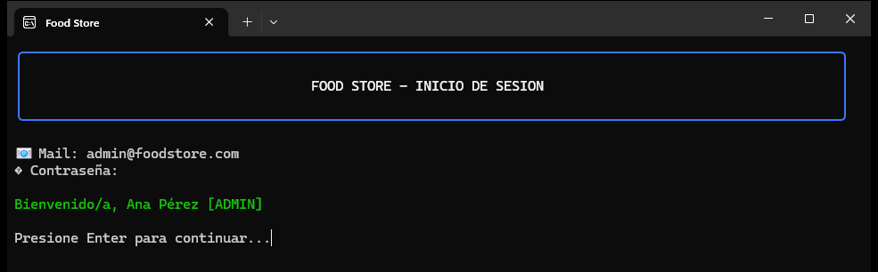
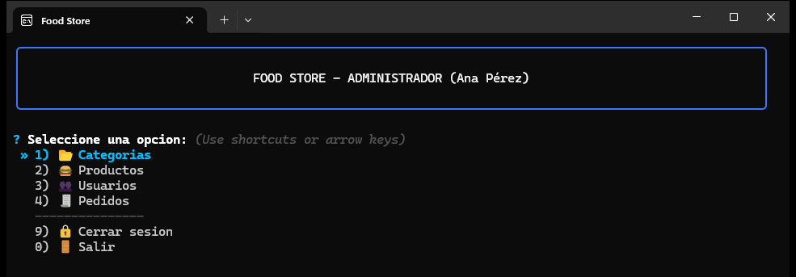
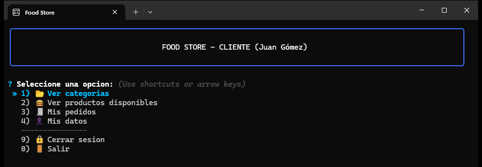

# Trabajo Práctico Integrador - Programación II

Repositorio correspondiente al Trabajo Práctico Integrador de la materia **Programación II** (UTN FRM).

## Descripción

**Food Store** es un sistema de consola para gestionar un negocio de comidas: categorías, productos, usuarios y pedidos. Está desarrollado en Python aplicando **Programación Orientada a Objetos** (clase abstracta, interfaz, herencia, polimorfismo, encapsulamiento, composición y agregación) y excepciones propias.

Al iniciar se pide mail y contraseña. Según el rol, se abre el **menú de administrador** (alta, baja, modificación y consulta) o el **menú de cliente** (solo consulta). Toda la información vive en memoria mientras el programa se ejecuta.

## Integrantes

| Nombre | Legajo | Correo |
|---|---|---|
| Luciano Pizarro | 54249 | luciano.pizarro@alumnos.frm.utn.edu.ar |
| Lautaro Martínez | 54277 | lautaroj.martinez@alumnos.frm.utn.edu.ar |

## Enlaces del proyecto

| Recurso | Enlace |
|---|---|
| Repositorio GitHub | https://github.com/LucianoP15/TPI_Programacion_2 |
| Video demostración | https://www.youtube.com/watch?v=7wX0WrGI0ag |
| Informe PDF | [informe.pdf](./informe.pdf) |

## Requisitos previos

1. **Python 3.12** o superior.
2. Dependencias del archivo `requirements.txt`:

```bash
pip install -r requirements.txt
```

Si tenés más de una versión de Python instalada:

```bash
python -m pip install -r requirements.txt
```

Las librerías usadas son `questionary` (menú interactivo) y `rich` (formato en consola).

## Ejecución

```bash
python main.py      # programa
python pruebas.py   # pruebas del modelo y servicios, sin menú
```

### Credenciales iniciales

| Rol | Mail | Contraseña |
|---|---|---|
| Administrador | admin@foodstore.com | admin123 |
| Cliente | juan@foodstore.com | cliente123 |

En los menús se navega con las flechas o con el número de cada opción, y se confirma con Enter.

## Estructura del proyecto

```text
main.py                     Punto de entrada: crea los servicios y arranca el login
pruebas.py                  Pruebas del modelo y servicios, sin menú
datos_iniciales.py          Administrador inicial y datos de ejemplo
entidades/                  Clases del UML
  base.py                   Base (abstracta)
  calculable.py             Interfaz Calculable
  categoria.py  producto.py  usuario.py  pedido.py  detalle_pedido.py
enums/                      Rol, Estado, FormaPago
excepciones/                FoodStoreError y sus subclases
servicios/                  Un servicio por entidad + ServicioBase
consola/
  dependencias.py           Verificación de librerías al inicio
  estilos.py                Títulos, mensajes y tablas
  entrada.py                Lectura validada desde teclado
  login.py                  Inicio de sesión
  menu.py                   Menu, MenuAdministrador, MenuCliente (polimorfismo)
  pantallas/                Pantallas de cada sección
requirements.txt            Dependencias del proyecto
assets/                     Capturas de pantalla del README y del informe
INFORME.md                  Borrador del informe (la versión entregada es informe.pdf)
```

La dependencia entre capas va en un solo sentido: **consola → servicios → entidades**.

## Ejemplos de uso

### Inicio de sesión

<p align="center">
  
</p>

### Menú de administrador

<p align="center">
  
</p>

### Menú de cliente

<p align="center">
  
</p>
